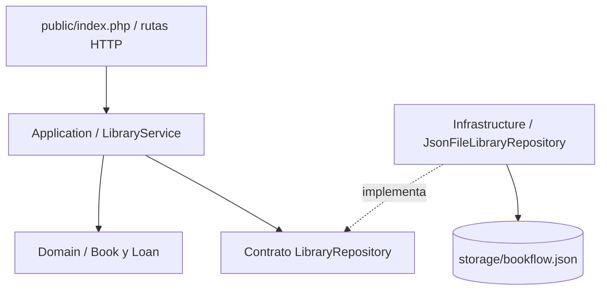

# BookFlow — API REST con PHP

API REST ligera para administrar libros, ejemplares, préstamos y devoluciones de una biblioteca. Se implementa sin depender de un framework, con el propósito de hacer visible la separación entre dominio, casos de uso, persistencia y capa HTTP.

> **Alcance:** proyecto personal de portafolio con datos ficticios. La persistencia en archivo JSON está pensada para una demostración local, no para múltiples usuarios concurrentes ni para producción.

## Funcionalidades

- Consultar y registrar libros.
- Mantener el total de ejemplares y las unidades disponibles.
- Registrar préstamos únicamente si hay disponibilidad.
- Registrar una devolución una sola vez.
- Validar las solicitudes y devolver códigos HTTP apropiados.
- Guardar los datos de demostración en `storage/bookflow.json`.

## Tecnologías y requisitos

- PHP 8.2 o superior, con extensión JSON habilitada.
- Composer 2.
- Servidor de desarrollo integrado de PHP.

## Arquitectura



- `src/Domain`: entidades y reglas de negocio.
- `src/Application`: contrato de repositorio y coordinación de casos de uso.
- `src/Infrastructure`: adaptador que persiste el estado en JSON.
- `public/index.php`: enrutamiento HTTP, lectura de solicitudes, códigos de estado y respuestas JSON.
- `storage/bookflow.json`: archivo local generado al guardar datos; no debe subirse al repositorio.

## Instalación y ejecución en Windows

Abre PowerShell en la raíz del proyecto y comprueba las herramientas:

```powershell
php --version
composer --version
```

Instala dependencias y arranca el servidor:

```powershell
composer install
php -S 127.0.0.1:8082 -t public public/index.php
```

Abre `http://127.0.0.1:8082/api/health` para comprobar el servicio. Las primeras operaciones de escritura crean el archivo local con datos de ejemplo.

## Endpoints

| Método | Ruta | Propósito |
|---|---|---|
| `GET` | `/api/health` | Estado de la API |
| `GET` | `/api/books` | Listar libros |
| `POST` | `/api/books` | Registrar libro |
| `GET` | `/api/loans` | Listar préstamos |
| `POST` | `/api/loans` | Registrar préstamo |
| `PATCH` | `/api/loans/{id}/return` | Registrar devolución |

Ejemplo para registrar un libro:

```json
{
  "title": "Clean Code",
  "author": "Robert C. Martin",
  "isbn": "9780132350884",
  "totalCopies": 3
}
```

Para crear un préstamo, utiliza un identificador real obtenido de `GET /api/books`:

```json
{
  "bookId": "ID_DEL_LIBRO",
  "borrowerName": "Alex Rivera",
  "dueDate": "2026-11-01T12:00:00Z"
}
```

## Diseño por capas y principios de código limpio

- La capa HTTP recibe solicitudes y construye respuestas, pero no contiene las reglas centrales del préstamo.
- `LibraryService` coordina los casos de uso y utiliza el contrato `LibraryRepository`.
- Las entidades del dominio verifican invariantes como disponibilidad y devolución única.
- `JsonFileLibraryRepository` es un adaptador de persistencia que puede reemplazarse por una implementación SQL sin introducir SQL en el dominio.

## Pruebas

El proyecto incluye pruebas para el dominio. Instala dependencias con Composer y ejecuta:

```powershell
composer test
```

Si el script `test` no está configurado en `composer.json`, utiliza PHPUnit directamente:

```powershell
vendor\bin\phpunit
```

## Limitaciones y mejoras pendientes

Este prototipo no incluye autenticación, autorización, límites de frecuencia, transacciones ni garantías de concurrencia. La escritura en JSON puede perder actualizaciones si varios procesos escriben simultáneamente. Para acercarlo a un escenario productivo, sustituye el adaptador por PostgreSQL o MySQL, incorpora transacciones, autorización, pruebas de integración, logging y CI.

## Contexto del proyecto

Proyecto personal de portafolio orientado a demostrar separación de responsabilidades y encapsulación de reglas de negocio en PHP. La versión publicada debe ejecutarse y probarse en el entorno local antes de considerarse validada.
