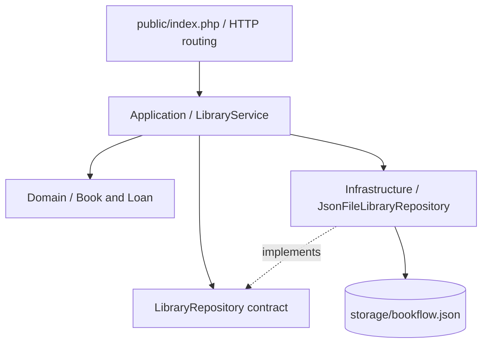

# BookFlow — PHP API

A lightweight PHP 8.2+ REST API implementing the same library-lending rules as the .NET and Node.js versions. It uses explicit Domain, Application, Infrastructure, and HTTP folders without requiring a framework, so the layering is visible and the app can be run with PHP's built-in development server.

## Features

- List and register books.
- Track total copies and available copies.
- Create loans when stock is available.
- Return loans once; duplicate returns are rejected.
- Validate request bodies and map business errors to HTTP status codes.
- Persist demo state in a local JSON file under `storage/bookflow.json`.

## Architecture



- `src/Domain`: business entities and invariants.
- `src/Application`: repository contract and use-case orchestration.
- `src/Infrastructure`: JSON-file persistence adapter.
- `public/index.php`: HTTP boundary, request parsing, status codes, JSON responses.
- `storage/bookflow.json`: generated local data file, ignored by Git.

## Requirements

- PHP 8.2 or newer with JSON enabled.
- Composer 2.

## Install and run

```powershell
composer install
php -S 127.0.0.1:8082 -t public public/index.php
```

Open `http://127.0.0.1:8082/api/health` or use the endpoints below. The first write creates `storage/bookflow.json` with sample books. This file is local state and must not be committed.

## Endpoints

| Method | Endpoint | Purpose |
|---|---|---|
| GET | `/api/health` | Health check |
| GET | `/api/books` | List books |
| POST | `/api/books` | Register a book |
| GET | `/api/loans` | List loans |
| POST | `/api/loans` | Register a loan |
| PATCH | `/api/loans/{id}/return` | Return a loan |

Example book body:

```json
{ "title": "Clean Code", "author": "Robert C. Martin", "isbn": "9780132350884", "totalCopies": 3 }
```

Example loan body (replace `bookId` with a real ID from `GET /api/books`):

```json
{ "bookId": "BOOK_ID", "borrowerName": "Alex Rivera", "dueDate": "2026-11-01T12:00:00Z" }
```

## Clean Code and SOLID

- HTTP routing does not own business logic.
- `LibraryService` coordinates use cases and depends on the repository contract.
- Domain entities enforce stock and return invariants.
- `JsonFileLibraryRepository` is an adapter; it can be replaced by a SQL repository without putting persistence code into domain entities.

## Limitations and production hardening

This is a portfolio demo, not production software. JSON-file persistence is appropriate only for a local demo and has limited concurrency guarantees. There is no authentication, authorization, rate limiting, database transaction, migration system, monitoring, or deployment configuration. Use fictional data only. For production, replace the JSON adapter with PostgreSQL/MySQL, add transaction/concurrency controls, tests, authentication/authorization, and deployment automation.

## Suggested improvements

- Add PHPUnit domain and service tests.
- Add a MySQL/PostgreSQL implementation of the repository.
- Add request DTOs and a framework adapter (for example Laravel) while keeping the domain/application layers isolated.
- Add CI for linting and tests.
